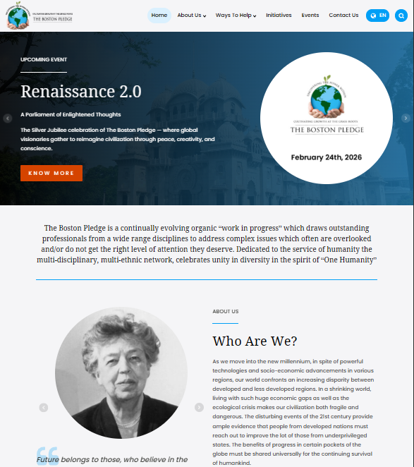
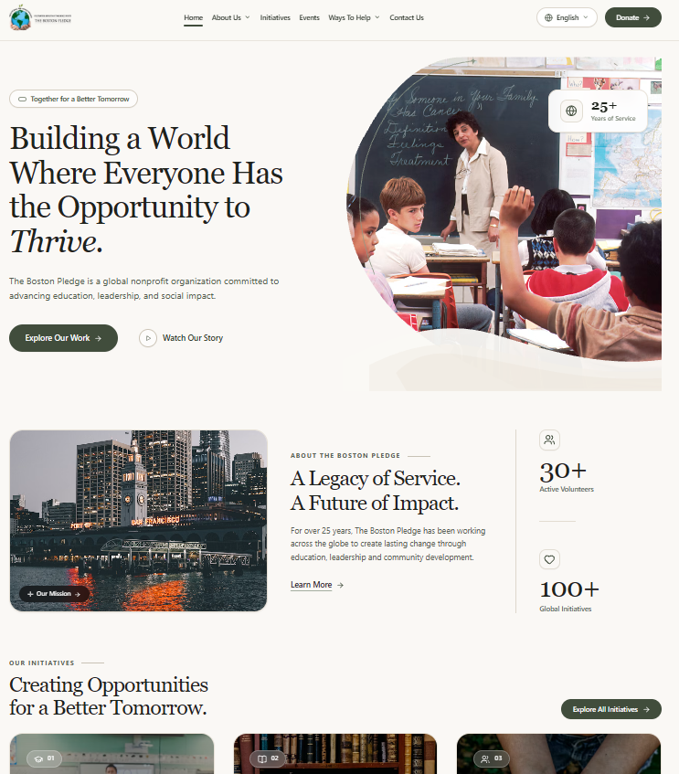

# The Boston Pledge — Web Platform

> A modern, high-performance web platform for **The Boston Pledge (TBP)** — a global 501(c)(3) fellowship dedicated to grassroots awakening, village self-reliance, and sustainable global equity through voluntary public service.

[](https://the-boston-pledge-website-redesign.vercel.app/)
[](https://nextjs.org/)
[](https://react.dev/)
[](https://www.typescriptlang.org/)
[](https://tailwindcss.com/)
[](https://pulsoicon.com/)
[](https://www.framer.com/motion/)
[](https://nextjs.org/)
[](LICENSE)

---

## 🌟 Overview

**The Boston Pledge (TBP)** is an independent, volunteer-driven non-profit incubator established in 2001 following the North American Bengali Conference in Boston, Massachusetts. Led by Chairman **Dr. Partha S. Ghosh** (distinguished strategist, author, former McKinsey partner, and faculty at Tufts and MIT) alongside an international council of corporate leaders, scholars, technologists, and grassroots champions, TBP operates **100% pro bono** with zero executive compensation.

This web platform serves as the central hub for TBP's initiatives, symposium proceedings, leadership perspectives, grassroots programs, volunteer intake, and donor engagement.

---

## 🔄 The Modern Transformation (Before vs. After)

A comprehensive redesign and architectural migration from the legacy platform to a modern, high-performance web experience:

- 🏛️ **Original / Legacy Website (Before Redesign)**: [https://thebostonpledge.org/](https://thebostonpledge.org/) *(Original site with dated layout and performance bottlenecks)*
- 🚀 **Redesigned Modern Website (After Redesign)**: [https://the-boston-pledge-website-redesign.vercel.app/](https://the-boston-pledge-website-redesign.vercel.app/) *(High-performance Next.js 16 platform deployed on Vercel)*

| Original Website (Before Redesign) | Redesigned Website (After Redesign) |
| :---: | :---: |
| [🔗 thebostonpledge.org](https://thebostonpledge.org/) | [🔗 the-boston-pledge-website-redesign.vercel.app](https://the-boston-pledge-website-redesign.vercel.app/) |
| <a href="https://thebostonpledge.org/"></a> | <a href="https://the-boston-pledge-website-redesign.vercel.app/"></a> |
| *Original layout with dated presentation and static content* | *Editorial aesthetic, warm earth tones, responsive layouts, and motion-reactive icons* |

### Key Improvements Made in the Redesign:
- **Visual Dignity & Branding**: Shifted from a dated, generic blue theme to an intentional, editorial color system (Warm Canvas `#FAF8F5`, Brand Olive `#414D3C`, Forest Deep `#242D21`, Warm Beige `#F3EDE3`) reflecting TBP's grassroots heritage.
- **Modern Typography Hierarchy**: Replaced standard fonts with an elegant pairing of classical serif headlines (`font-serif`) for dignified editorial gravitas and clean sans-serif body copy (`Geist`).
- **Motion-Reactive Micro-Interactions**: Integrated `pulsoicon-react` for animated vector icons that fluidly animate upon button hover, link focus, and interactive card interaction.
- **Card-Level Scroll Animations**: Fluid staggered entrance animations using Framer Motion (`<ScrollReveal>`) that guide the eye without causing cumulative layout shift.
- **Full Smartphone & Tablet Responsiveness**: Re-engineered navigation with a compact mobile header, smart slide-away navbar on scroll, collapsible accordion submenus, and touch-optimized form inputs.

---

## ✨ Key Features

- **⚡ Static Site Generation (SSG)**: 56 fully pre-rendered static routes compiled with Next.js App Router for instant page transitions, zero database latency, and optimal SEO.
- **🎨 Editorial & Earth-Inspired Design**: Custom typography combining classical serif headings with modern sans-serif body copy, warm canvas tones (`#FAF8F5`), and brand olive accents (`#414D3C`).
- **💫 Interactive Animated Icons**: Integrated with `pulsoicon-react`, delivering fluid vector micro-animations on button hover, link focus, and interactive card triggers.
- **📱 Responsive & Mobile-First**: Tailored layouts for smartphones, tablets, and desktop displays with smart header scroll behaviors and optimized touch targets.
- **🌊 Card-Level Scroll Motion**: Staggered scroll animations via Framer Motion with automatic form isolation to maintain 100% stable input focus.
- **🌐 Internationalization**: Seamless Google Translate integration with clean layout preservation and banner suppression.
- **📋 Purpose-Built Portals**: Accessible volunteer onboarding, 501(c)(3) tax-deductible donation intake, and multimedia symposium archives.

---

## 🛠️ Technologies & Tools Used

A comprehensive breakdown of all technologies, libraries, and tools utilized to build this platform:

### 1. Core Framework & Architecture
- **[Next.js 16.4.6](https://nextjs.org/) (App Router)**: Powers server-side compilation, dynamic routing (`[slug]`, `[id]`), metadata generation, and full Static Site Generation (SSG).
- **[React 19.3.0](https://react.dev/)**: Utilizes the latest React component architecture with clean separation of Server and Client Components (`"use client"`).
- **[TypeScript 5](https://www.typescriptlang.org/)**: Strict static typing across all components, props, and content models for end-to-end reliability.
- **[Turbopack](https://turbo.build/pack)**: Next-generation high-speed Rust-based bundler powering lightning-fast local development and production builds.

### 2. Styling & Design System
- **[Tailwind CSS 4.3.3](https://tailwindcss.com/)**: Modern utility-first CSS engine with `@tailwindcss/turbopack` integration for responsive layouts and custom theme tokens.
- **Editorial Color Palette**:
  - `Brand Olive (#414D3C)`: Primary action buttons, badges, active states, and accents.
  - `Olive Dark Hover (#323D2E)`: High-contrast interactive hover states.
  - `Forest Deep (#242D21)`: Dark card backgrounds and footer grounding.
  - `Warm Canvas (#FAF8F5)`: Primary soothing page background.
  - `Warm Beige Light (#F3EDE3)`: Highlighted section bands and secondary cards.
- **Typography**: Classical editorial serif (`font-serif`, Georgia / Times New Roman) paired with modern sans-serif (`Geist` via `next/font`).

### 3. Motion, Animation & Iconography
- **[PulsoIcon React 6.2.0](https://pulsoicon.com/)**: Hand-crafted motion-reactive animated vector icons. Automatically plays animations on interactive ancestor events (`button`, `a`, `[data-icon-trigger]`) with zero extra wrapper layers.
- **[Framer Motion 14.14](https://www.framer.com/motion/)**: Powers card-level `<ScrollReveal>` entrance effects with index-staggered delays and smooth modal transitions.
- **Scroll Progress Ring**: Custom circular SVG tracking viewport scroll progress within the `<ScrollToTop>` component.

### 4. Interactive Integrations & Media
- **Google Translate**: Custom-styled non-intrusive language selector pill with automatic suppression of intrusive top Google banners (`.goog-te-banner-frame`).
- **Google Maps Embed**: Live interactive map display for the Winchester, MA headquarters.
- **YouTube IFrame API**: Responsive embedded video players for symposium speeches and the vision story modal.
- **Photo & Video Lightbox**: Interactive dual-mode gallery modal with category filtering and keyboard accessibility.

---

## 🗺️ Site Architecture & Complete Route Map

Every page is statically pre-rendered at build time with `generateStaticParams()` across **56 routes**:

| Section | Route | Key Modules & Description |
|---|---|---|
| **Home** | `/` | Hero banner with video story modal, AboutPreview, InitiativesGrid, UpcomingEvent (Renaissance 2.0), LeadershipPreview, LatestEventsSection, NewsSection. |
| **About Us** | `/about` | Institutional background, legacy timeline, guiding principles (`MissionPillars`), governance structure, and leadership directory. |
| **Vision & Mission** | `/about/vision-mission` | Strategic vision, foundational doctrines, core objectives, and founder quote banners. |
| **Our Team** | `/about/our-team` | Biographies and advisory council directory with live filtering pills ("All", "Officers", "Directors", "Strategic Initiatives") and interactive bio modals. |
| **Media Gallery** | `/about/media` | Curated photo frames and video dispatches with full-screen lightbox viewing. |
| **Constitution** | `/about/constitution` | The Boston Pledge charter, 6 Core Values, Rabindranath Tagore quote banner, and navigational compass card. |
| **Reflections** | `/about/reflections` | Chairman biography, featured addresses, and symposium keynote archives. |
| **Initiatives Hub** | `/initiatives` | 5 programmatic pillars (Digital Connectivity, Youth Fellowships, EdSP, ESP, and Rural Innovation) with alternating visual layouts. |
| **Initiative Details** | `/initiatives/[id]` | 5 statically prerendered deep-dive initiative case studies and programs. |
| **Events Hub** | `/events` | Comprehensive event timeline, category filters, and interactive event cards. |
| **Event Details** | `/events/[slug]` | 23 statically prerendered conference proceedings with speaker lineups, agendas, and registration links. |
| **Latest Updates** | `/latest-updates` & `[slug]` | Field impact articles, webinar summaries, and rich content block renderer. |
| **Volunteer Portal** | `/be-a-volunteer` | Volunteer ethos, guidelines, eligibility criteria, and digital application form. |
| **Donate Portal** | `/donate` | 501(c)(3) public charity tax-deductible donation portal with preset impact tiers ($10, $20, $30, $40). |
| **Contact** | `/contact` | Headquarters location, direct inquiry form, and interactive Google Maps embed. |

---

## 📁 Project Structure

```text
boston-pledge/
├── app/                          # Next.js App Router pages and layouts
│   ├── about/                    # About overview & sub-routes (vision, team, media, etc.)
│   ├── be-a-volunteer/           # Volunteer application portal
│   ├── contact/                  # Contact channels and map
│   ├── donate/                   # 501(c)(3) donation portal
│   ├── events/                   # Events hub & dynamic [slug] routes (23 static pages)
│   ├── initiatives/              # Initiatives hub & dynamic [id] routes (5 static pages)
│   ├── latest-updates/           # News & updates [slug] routes (7 static pages)
│   ├── layout.tsx                # Root layout (Navbar, Footer, ScrollToTop)
│   └── page.tsx                  # Home landing page
├── components/                   # Modular React UI components
│   ├── about/                    # About page components & mission pillars
│   ├── common/                   # Shared UI: Navbar, Footer, Logo, ScrollReveal, ScrollToTop
│   ├── constitution/             # Charter, values, and guidelines
│   ├── contact/                  # Inquiry form and map view
│   ├── donate/                   # Impact cards and donation form
│   ├── events/                   # Event feed, event cards, and detail layouts
│   ├── home/                     # Homepage sections (Hero, Previews, Events, News)
│   ├── initiatives/              # Program pillars and detail templates
│   ├── latest-updates/           # Update feeds and rich content block renderer
│   ├── media/                    # Photo/video gallery with modal lightbox
│   ├── our-team/                 # Leadership directory, filter pills, and bio modals
│   ├── reflections/              # Chairman bio, video dialogue, and speeches archive
│   ├── vision-mission/           # Doctrines, mission goals, and quote banners
│   └── volunteer/                # Volunteer principles, guidelines, and application
├── lib/                          # Immutable data models and typed content stores
│   ├── eventsDetails.ts          # Comprehensive conference records (23 events)
│   ├── Initiatives.ts            # Strategic initiative framework definitions
│   ├── latestUpdatesData.ts      # Articles and media content blocks
│   ├── ourTeamDetails.ts         # Leadership council biographies
│   └── volunteerData.ts          # Volunteer guidelines and form schemas
├── public/                       # Static images, logos, and transition assets
│   ├── transition_photo/         # Before & After transformation screenshots
│   ├── logo.png                  # The Boston Pledge official logo
│   └── favicon.ico               # Site favicon
├── next.config.ts                # Next.js compiler & routing configuration
├── package.json                  # Project dependencies and npm scripts
└── tsconfig.json                 # TypeScript strict compiler options
```

---

## 🚀 Getting Started & Development

### Prerequisites
- **Node.js**: `v18.18.0` or higher (Node 20+ recommended)
- **Package Manager**: `npm` (or `pnpm` / `yarn`)

### Installation & Local Setup

1. **Clone the repository**:
   ```bash
   git clone https://github.com/your-username/boston-pledge.git
   cd boston-pledge
   ```

2. **Install dependencies**:
   ```bash
   npm install
   ```

3. **Start the local development server**:
   ```bash
   npm run dev
   ```

4. **Access the application**:
   Open [http://localhost:3000](http://localhost:3000) in your browser with instant hot-reloading.

---

## 📜 Available Scripts

| Command | Description |
|---|---|
| `npm run dev` | Cleans `.next` cache and starts the Turbopack development server. |
| `npm run build` | Compiles TypeScript and prerenders all 56 static routes. |
| `npm run start` | Runs the production build locally. |
| `npm run lint` | Runs ESLint to verify codebase formatting and rules. |
| `npm run clean` | Safely removes the `.next` build cache directory. |
| `npx tsc --noEmit` | Performs standalone TypeScript type verification. |

---

## 🏛️ Governance & Organization

- **Organization**: The Boston Pledge (TBP)
- **Classification**: 501(c)(3) Non-Profit Public Charity *(all leadership serves 100% pro bono)*
- **Chairman**: Dr. Partha S. Ghosh
- **Headquarters**: 7 Wainwright Rd Unit 66, Winchester, MA 01890, USA
- **Contact**: [contact@thebostonpledge.org](mailto:contact@thebostonpledge.org)
- **Redesigned Version (After Redesign)**: [https://the-boston-pledge-website-redesign.vercel.app](https://the-boston-pledge-website-redesign.vercel.app/)
- **Original Legacy Website (Before Redesign)**: [https://thebostonpledge.org](https://thebostonpledge.org)

---

## 📄 License

This project is open-source under the [MIT License](LICENSE).

*© 2026 The Boston Pledge. All rights reserved. Built for compassionate, bottom-up global empowerment.*
